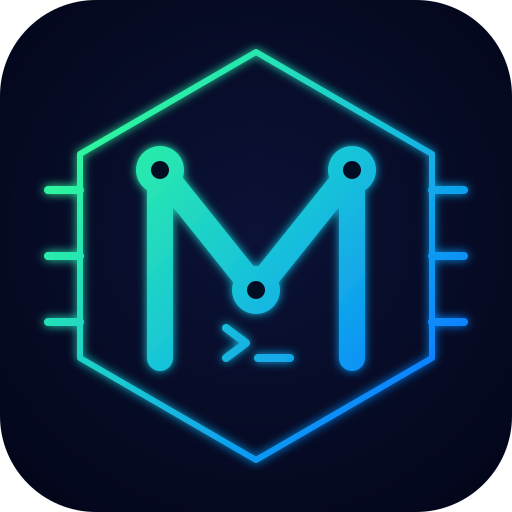

<div align="center">
  
  <h1>Mujard</h1>
  <p><strong>Bare code. Every board.</strong></p>
  <p>
    <a href="https://mujard.com">Website</a> ·
    <a href="docs/lang/MUJARD_LANGUAGE_SPEC.md">Specification</a> ·
    <a href="ROADMAP.md">Roadmap</a> ·
    <a href="HISTORY.md">History</a>
  </p>
</div>

Mujard is a small programming language and toolchain for microcontrollers. Programs are
written in `.muj` (or `.mjd`) files, checked by a real compiler, and built into firmware
for the boards the Arduino ecosystem supports — AVR, ESP32, ESP8266, Raspberry Pi Pico,
SAMD, megaAVR, Renesas and mbed families.

The toolchain is pure Go and runs on **Windows, Linux and macOS**; the same checker also
ships as a **WASM build** for browser-based editors.

This repository holds the **open-source parts** of Mujard, licensed under
[Apache-2.0](LICENSE):

| Path | What it is |
|---|---|
| `tools/mujard` | The `mujard` command line (Go): the language compiler (`check`, `gen`, `fmt`, `test`, `repl`, `lsp`), the language server, the WASM build used by editors, and the client for the hosted build service |
| `tools/mujard/lang` | The language implementation: lexer, parser, checker and the C++ code generator |
| `tools/mujard/lang/runtime` | `mujard_rt` — the C++ runtime and feature headers generated programs link against |
| `tools/mujard/lang/descs` | `.mlib` library descriptions used by `use "..."` |
| `tools/mujard-build` | The direct build backend: compiles generated sketches locally with `arduino-cli`-free toolchains |
| `toolchain/` | Board manifests, package descriptors and the sha256-pinned download index |
| `docs/lang` | The language specification, README, reference and learn-by-example tutorials |

**The language is free — always.** No account, developer key or payment is needed to write, check,
test or build Mujard programs: the compiler, the `mujard` command line and the offline
`mujard-build` backend are the open-source parts and cost nothing. Only the optional hosted
build service (cloud builds, the AI assistant) belongs to the proprietary platform and uses
its coin system.

The hosted platform (accounts, cloud builds, the web/Android/desktop apps, the backend API)
is **not** part of this repository.

## Quick start

**Prebuilt binaries** — every release ships `mujard` and `mujard-build` for Windows,
Linux and macOS (amd64 + arm64) under
[Releases](https://github.com/mujard-language/mujard-language/releases), with sha256
checksums. Unzip, put the binary on your PATH, done.

**From source** — you need [Go](https://go.dev) 1.26+ and a C++ compiler (`g++` or
`clang++`) for `mujard test`/`repl`:

```sh
cd tools/mujard
go build -o mujard .
./mujard --help
```

`tools/mujard-build` builds the same way (`go build -o mujard-build .`) — it is the
direct firmware backend used by `mujard build --backend direct`.

Try the language without any hardware or account:

```sh
mujard new blink --board uno     # creates blink/blink.muj
mujard check blink/blink.muj     # errors and warnings, file:line:col
mujard test blink/blink.muj      # runs the test blocks on a simulated board
mujard gen blink/blink.muj       # writes the generated C++ to blink.gen/
mujard repl --board uno          # interactive prompt on the simulated board
```

`mujard lsp` is the language server for editors; `mujard fmt` rewrites a program in the
standard layout; `mujard boards caps <board>` shows how far each capability is proven on
a board (hardware / build / backend / none). `mujard serial <port>` watches a board's
serial output (with the desktop app), `mujard logs` prints the upload/burn traces this PC
keeps, and `mujard doc <dir>` writes the language reference pages.

## Building firmware

* **Locally:** `mujard build <board> <sketch>` with `arduino-cli` installed, or the
  `mujard-build` direct backend (`--backend direct`) which uses the pinned toolchains in
  `toolchain/` — no Arduino IDE needed.
* **Hosted:** `mujard build` against the Mujard build service with a developer key
  (`mujard login`). That service is part of the proprietary platform.

## Documentation

* [docs/README.md](docs/README.md) — the documentation index: where to start, the
  specification, reference, tutorials and examples
* [HISTORY.md](HISTORY.md) — how the project got here, milestone by milestone
* [ROADMAP.md](ROADMAP.md) — what is done, what is next
* [CONTRIBUTING.md](CONTRIBUTING.md) — how to propose and land changes
* [docs/lang/MUJARD_LANGUAGE_SPEC.md](docs/lang/MUJARD_LANGUAGE_SPEC.md) — the normative
  language specification
* [docs/lang/README.md](docs/lang/README.md) — every built-in, with examples
* [tools/mujard/README.md](tools/mujard/README.md) — the full `mujard` command reference

## Specification and governance

* Language changes follow the RFC process and the "three homes" rule: parser,
  specification EBNF and goldens change together (see CONTRIBUTING.md).
* Security reports: see [SECURITY.md](SECURITY.md). Contributions: see
  [CODE_OF_CONDUCT.md](CODE_OF_CONDUCT.md) and the DCO sign-off convention.
